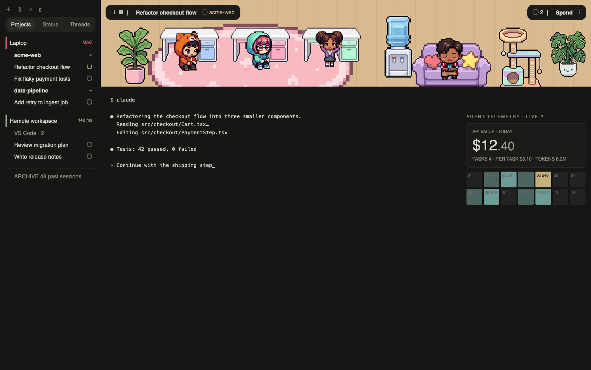

# Loft



A Herdr layout: projects, status and threads in a sidebar; floating top-bar islands; an office scene above the terminals; a Spend panel on the right. Renamed fork of Kanso v3.30.0 (see NOTICE.md).

## Install

```sh
cp layouts/loft.json ~/.config/herdr-app/layouts/
cp themes/*.json      ~/.config/herdr-app/themes/
cp -R mods/*         ~/.config/herdr-app/mods/   # loft-* plus office
herdr-app do layout.switch '{"name":"loft"}'
```

Switch back with `ctrl-shift-l`. Back up any existing `loft-*` mod folders first, because the copy overwrites them.

## Before you use it

- The Spend panel reads local agent logs (`~/.claude`, `~/.codex`, `~/.pi`, OpenCode's database). The sidebar probes (`outside.py`, `archive.py`) read the same places. Nothing is sent anywhere.
- `mods/loft-spend/main.js` line 33: `WS_NAME` names the remote workspace whose logs Spend mirrors with `au-sync` (a personal script, not included). Spend works without it; set it to your own workspace name or ignore it.
- Self-updaters are disabled on purpose.

## Status

- Every mod passes `herdr-app check`.
- `preview.png` is an illustrative mock-up with dummy data, not a screenshot of a live window.

## Credits

Loft stands on other people's work. Thank you to:

- **jlopezlira** — [Kanso](https://github.com/jlopezlira/herdr-kanso), the layout and mods this is forked from (v3.30.0, Apache-2.0).
- **0OZ, José Gutiérrez and Iván Campaña** — earlier changes to the sidebar mod that Kanso builds on.
- **DustyPolk** — [herdr-office](https://github.com/DustyPolk/herdr-office), the pixel office scene in `mods/office`, included here with local changes.
- **Herdr** — the app and the original `spaces` mod ([herdrdev/herdr-app](https://github.com/herdrdev/herdr-app), Apache-2.0).

If you are one of the authors above and want something changed or removed, open an issue. Licence and change details are in NOTICE.md.
