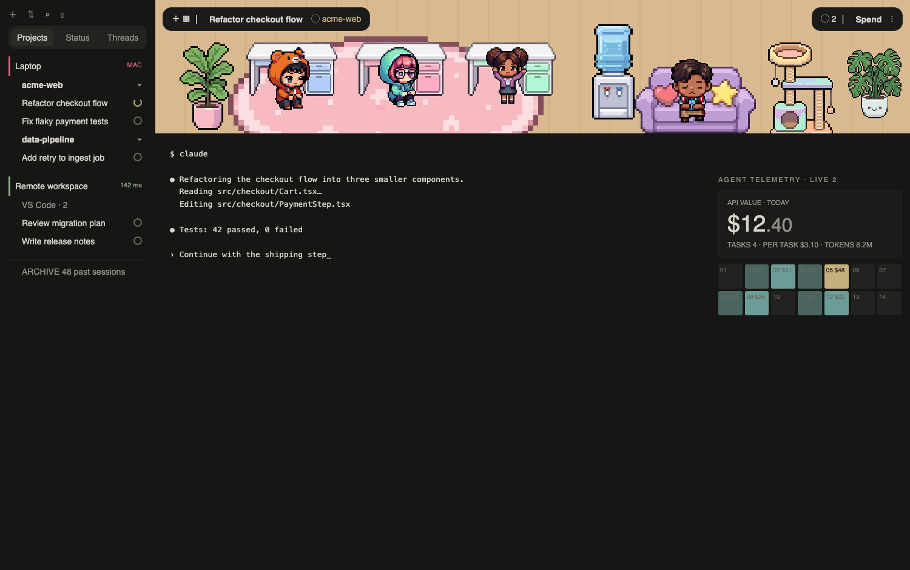

# Kanso (modified)

A dark, quiet Herdr layout for people who run many coding agents at once. A sidebar lists every project and conversation, across this Mac and any remote workspace. Above the terminals is a small pixel office where each agent is a coworker. Two floating islands on top hold the current agent's title and the panel buttons. A Spend panel on the right shows what the agents cost.

## What you see

Left to right: sidebar (256px), main column, optional right panel.

- **Sidebar.** Three tabs: Projects, Status, Threads. A toolbar above them has new, sort, search and fold buttons. Projects are grouped by machine. Each machine has a coloured stripe and a tag (MAC in the accent colour, remote machines show their round-trip time in milliseconds: green under 250, amber under 700, red above). Under each machine, projects list their agents with a status ring. A "VS Code" group lists agents running outside Herdr. At the bottom, an "Archive" group lists past sessions (collapsed by default). A 64px footer holds the account, server and settings buttons.
- **Top bar.** Two floating islands over the office. Left: new tab, arrangements, the current agent's descriptive title with its status, and project and branch. Right: an agent summary chip and the Files, Spend, PR and Worktrees buttons, with a menu for the rest. There are no tab pills.
- **Office.** 220px tall, flush with the window's top and right edges, a top-down view with a deep floor and no walls. A 46px band at the top is kept clear for the islands. Work zone with desks on the left, lounge on the right (couch, cat tree, chalkboard with counts and the time).
- **Terminals.** Below the office, with 6px padding. A pane header shows the descriptive name only when a tab has more than one pane.
- **Spend panel.** Today / Month / 30D / Year / All, a headline value with change against the previous period, tasks, value per task and tokens, a day heatmap, and the agents running now.

## How it behaves

- **Agent status.** Working: spinner in the sidebar, typing at the desk. Blocked: hand up at the desk, and after five minutes the fire alarm. Done: cheering in confetti until you look. Idle: ring in the sidebar, chatting at the cooler, then napping on the couch. Sleeping: an "Asleep" row with a Wake pill and a Forget button (click twice).
- **Descriptive names.** A terminal's name is, in order: the name you gave it, the conversation title, a named tab (unless it only repeats the program), the live title, the shell's folder, the program.
- **Outside agents.** Every 15s (60s when the window is in the background) the sidebar probes each machine for Claude Code, Codex and pi processes that did not start in Herdr. They appear under "VS Code" and as desk workers tagged "VS" in the office. Clicking a sidebar row copies its session id.
- **Archive.** Newest 300 sessions from Claude Code, Codex, pi and OpenCode, 25 rows then "Show N more". Clicking a row opens a new terminal that runs `claude --resume <id>`, `codex resume <id>`, `pi --session <id>` or `opencode --session <id>` in the session's folder.
- **OpenCode.** Herdr does not recognise OpenCode, so its terminals are found by program name. Status is read from OpenCode's database every 3s: working when the newest message is an assistant message with no completion time, updated in the last 2 minutes.
- **Keys.** `ctrl-shift-i` toggles the office. `ctrl-shift-l` switches layout.
- **Night.** Office lights go down from 20:00 to 06:00.

## Built from

- Layout `layouts/kanso.json`: root row `[sidebar, main-col]`. `sidebar` is a column of `brand` (hidden), `spaces` (`kanso-spaces`) and `sidebar-footer` (`kanso-chrome`, prop `footer: true`). `main-col` is a column of `office` (the `office` mod, 220px, with two floating blocks of `kanso-tabs`, props `part: "title"` and `part: "panels"`) and `work` (padding 6, holding the terminals and `kanso-strip` rulers).
- Mods: `kanso-spaces`, `kanso-chrome`, `kanso-tabs`, `kanso-strip`, `kanso-spend`, plus the helper mods the sidebar and top bar open (`kanso-arrange`, `-containers`, `-dojo`, `-guard`, `-help`, `-menu`, `-panel`, `-prompt`, `-prompt-editor`, `-send`, `-settings`, `-sim`, `-sleep`, `-status`, `-toast`). `office` is DustyPolk's herdr-office mod, included with local changes (see NOTICE.md).
- Fork of Kanso v3.30.0 (Apache-2.0). See NOTICE.md.
- Programs it runs: `outside.py`, `archive.py` and `piwork.py` (read-only probes that list processes and session files), read through `exec` and `hc` on each machine. They read `~/.claude`, `~/.codex`, `~/.pi` and OpenCode's `opencode.db`. Nothing is sent to the network.

## Watch out

- Never hide the `status-row` / strip minimap with `layout.hide`. The pane model runs inside that block, and hiding it stops tab and sidebar clicks from switching the terminal.
- Floating-block props must be strings. A boolean such as `float: true` never reaches the mod.
- The self-updaters in `kanso-chrome/update.js` and `kanso-tabs/update.js` are stubs on purpose: an update replaces every `kanso-*` mod and wipes these changes.
- `kanso-spend` mirrors one remote workspace with `au-sync`, a personal script that is not included. Spend works for the local Mac without it.
- Codex detection was only tested against an old rollout file, not a live process.
- Tested on Herdr with Kanso v3.30.0 as the base.

## Done when

- `herdr-app check` passes on every `mods/kanso-*` folder.
- `layout.switch {name: "kanso-modded"}` shows the sidebar, the office with the two islands, and terminals underneath.
- A Claude Code session started outside Herdr appears in the "VS Code" group within a minute.
- The Archive group lists past sessions, and clicking one starts it with the right resume command.
- `ctrl-shift-i` hides and shows the office.
